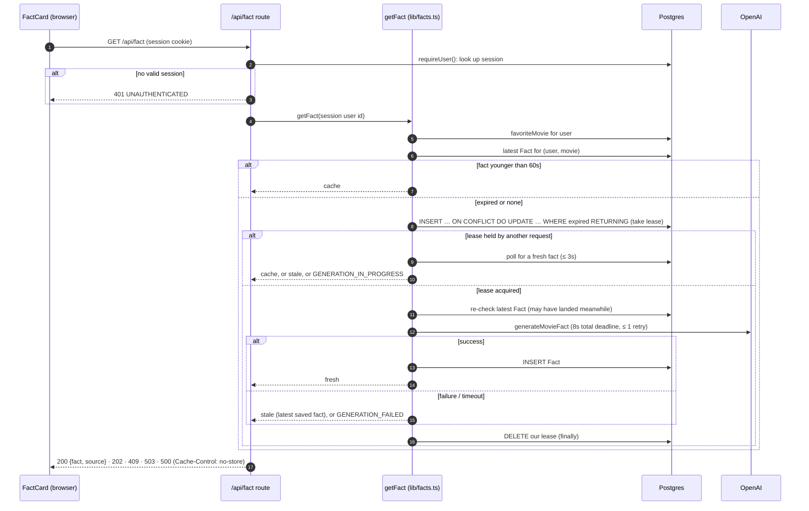

# Movie Memory

Sign in with Google, tell us your favorite movie, and get a fun fact about it from OpenAI.

Built with Next.js 16 (App Router), React 19, Tailwind 4, PostgreSQL 16, Prisma 7,
Auth.js v5 (Google) and the OpenAI API. Implements the base app plus **Variant A
(backend: caching and correctness)**.

> **Live app:** https://VERCEL_URL_HERE
> (sign-in is limited to Google test users while the OAuth app is in "Testing"; ask for access)
>
> **Repository:** https://github.com/Sanket1815/Movie-Memory
>
> **Demo video:** _link to be added_

---

## 1. Variant chosen: A (backend: caching and correctness)

I chose Variant A because the interesting problems in this app are on the server: an
external API that is slow, costs money and fails; many requests for the same user arriving
at once (refreshes, several tabs, several serverless instances); and authorization around
per-user data. Variant A exercises exactly that: data modeling, a correct cache window, a
concurrency guard that works across instances, and safe failure handling with tests that
run against real Postgres. It is also closest to the work this role describes (Node.js,
PostgreSQL, OAuth, external API integration, serverless concurrency, security).

---

## 2. Local setup

### Prerequisites

- **Node.js 24** (see `.nvmrc`). Prisma 7 refuses to run on Node < 22.18; check with
  `node -v`. Install from https://nodejs.org, `nvm install 24`, or on Windows
  `winget install OpenJS.NodeJS.LTS`.
- **Docker** (Docker Desktop on Windows/macOS) for the local Postgres.
- A **Google OAuth client** and an **OpenAI API key** with credit (see below).

### Steps

```bash
# 1. Get the code
git clone https://github.com/Sanket1815/Movie-Memory.git
cd Movie-Memory

# 2. Configure environment variables
cp .env.example .env              # Windows PowerShell: Copy-Item .env.example .env
#    then edit .env: set AUTH_SECRET, AUTH_GOOGLE_ID, AUTH_GOOGLE_SECRET, OPENAI_API_KEY
#    (DATABASE_URL and DATABASE_URL_TEST are already correct for docker-compose)

# 3. Start Postgres 16 (localhost:54330) and the separate test database
docker compose up -d

# 4. Install dependencies (also generates the Prisma client via postinstall)
npm install

# 5. Create the tables
npx prisma migrate dev

# 6. Run the app
npm run dev                       # http://localhost:3000
```

Then open http://localhost:3000 → **Sign in with Google** → enter a favorite movie → the
dashboard shows your profile, movie and a fun fact.

Postgres is exposed on host port **54330** (not 5432) to avoid clashing with a local install.
To stop it: `docker compose down` (data is kept in the `pgdata` volume; add `-v` to wipe it).

### Troubleshooting

| Symptom | Fix |
|---|---|
| `TypeError: (0, Pt.styleText) is not a function` from Prisma | Node is too old; install Node 24 and open a new terminal |
| Server won't start: "Invalid environment variables" | A value in `.env` is missing; the message lists which |
| Google shows `redirect_uri_mismatch` | Redirect URI must be exactly `http://localhost:3000/api/auth/callback/google` |
| Google shows `access_denied` | Add your account under **Audience → Test users** in Google Cloud |
| Fact card says "We couldn't come up with a fact" | OpenAI call failed; check the key and that the account has credit |
| `Port 3000 is in use` | Stop the other app, or run `npm run dev -- -p 3001` (and register that port in Google) |

### Environment variables

All are server-only; none use the `NEXT_PUBLIC_` prefix. `lib/env.ts` validates them with
Zod when the server starts and lists anything missing.

| Variable | Purpose | Where to get it |
|---|---|---|
| `DATABASE_URL` | App database | Prefilled in `.env.example` for docker-compose |
| `DATABASE_URL_TEST` | Test database (must end in `_test`) | Prefilled; created by `docker/init-test-db.sql` |
| `AUTH_SECRET` | Signs/encrypts Auth.js cookies | `npx auth secret` (or any 32+ random bytes, base64) |
| `AUTH_GOOGLE_ID` | Google OAuth client ID | Google Cloud Console (below) |
| `AUTH_GOOGLE_SECRET` | Google OAuth client secret | Google Cloud Console (below) |
| `OPENAI_API_KEY` | OpenAI API key | https://platform.openai.com/api-keys (account needs credit) |
| `OPENAI_MODEL` | Optional model override | Defaults to `gpt-6-luna` |

### Google OAuth setup

1. https://console.cloud.google.com → create a project.
2. **APIs & Services → OAuth consent screen** (Google Auth Platform): app name, support
   email, audience **External**. Under **Audience → Test users**, add the Google accounts
   that will sign in (required while the app is in "Testing").
3. **Clients → Create client → Web application**:
   - Authorized JavaScript origin: `http://localhost:3000`
   - Authorized redirect URI: `http://localhost:3000/api/auth/callback/google`
4. Copy the client ID and secret into `.env`.

No Google APIs need enabling; Auth.js only requests `openid email profile`.

### Database migrations

| Command | When |
|---|---|
| `npx prisma migrate dev` | Local development: applies migrations (and creates new ones after schema edits) |
| `npm run db:deploy` (`prisma migrate deploy`) | CI / production: applies pending migrations only, never resets |
| `npm test` | Migrates the test database automatically before running (`tests/global-setup.ts`) |

### Scripts

`dev`, `build`, `start`, `lint`, `typecheck` (`next typegen && tsc --noEmit`), `test`,
`test:watch`, `db:migrate`, `db:deploy`.

---

## 3. Architecture overview

### Folder structure

```
app/
  page.tsx                     Landing page ("Sign in with Google"); signed-in users → /dashboard
  auth-actions.ts              Server actions: sign in (→ /dashboard), sign out (→ /)
  onboarding/page.tsx          First-time only; guards + form
  onboarding/OnboardingForm.tsx  Client form (useActionState): inline errors, pending state
  onboarding/actions.ts        Server action: validate (Zod) + save movie for the session user
  dashboard/page.tsx           Server component: profile, movie, logout; guards
  dashboard/FactCard.tsx       Client component: loading / fact / stale / error states
  api/auth/[...nextauth]/route.ts  Auth.js endpoints (Google OAuth callback etc.)
  api/fact/route.ts            GET: fact for the signed-in user (thin: auth → getFact → JSON)
lib/
  auth.ts        Auth.js config (Google, Prisma adapter, database sessions), requireUser()
  facts.ts       getFact(): 60s cache, lease lock, fallback; all Variant A logic lives here
  openai.ts      generateMovieFact(): deadline, retry policy, output sanitizing
  db.ts          Prisma client (driver adapter for node-postgres), dev-safe singleton
  env.ts         Zod-validated env, fails fast at startup (via instrumentation.ts)
  validation.ts  movieSchema (trim, 1–100 chars, no control/invisible-only input)
  errors.ts      Shared error codes and the { error: { code, message } } response shape
  api-types.ts   JSON contract of GET /api/fact, shared by route and client
  display.ts     Name/initials fallbacks for missing Google profile data
prisma/          schema.prisma + migrations
tests/           Vitest suites against a real Postgres test database
```

Business logic lives in `lib/`. Routes, pages and actions only authenticate, call into
`lib/`, and translate results to HTTP or UI. There is no separate backend server.

### Auth and routing

- **Auth.js v5 + Google + Prisma adapter, database sessions.** The cookie holds only a
  random token; the session is a row in `Session`. Logging out deletes the row, so the
  session is revoked immediately (a JWT would remain valid until it expired).
- **One "new vs returning" check.** Sign-in always redirects to `/dashboard`. The dashboard
  reads `User.favoriteMovie`: `NULL` means first-time, so it redirects to `/onboarding`. No
  separate "onboarded" flag can drift out of sync with the data.
- **All guards run server-side** in server components (real 307 redirects, no flicker):

  | Route | Logged out | Signed in, no movie | Signed in, has movie |
  |---|---|---|---|
  | `/` | landing page | → `/dashboard` → `/onboarding` | → `/dashboard` |
  | `/onboarding` | → `/` | form | → `/dashboard` |
  | `/dashboard` | → `/` | → `/onboarding` | dashboard |

- **The user id only ever comes from the session** via `requireUser()` / `getCurrentUser()`.
  No route or action reads a user id from the URL, body or headers.
- Next 16's `cacheComponents` (Partial Prerendering) is **off**: every page is per-user, it
  would stream pages (so a redirect after the shell is sent is no longer a clean 307), and
  it forbids the `runtime = "nodejs"` segment config used for the DB-backed routes.

### Data model

```prisma
model User {                      // + Auth.js fields: name, email, emailVerified, image
  favoriteMovie String? @db.VarChar(100)
  facts         Fact[]
  factLock      FactLock?
}

model Fact {
  id        String   @id @default(cuid())
  userId    String
  movie     String   @db.VarChar(100)   // title copied at generation time = cache key
  content   String
  createdAt DateTime @default(now())
  @@index([userId, movie, createdAt(sort: Desc)])
}

model FactLock {
  userId      String   @id               // one lease per user
  lockedUntil DateTime @db.Timestamptz(3)
}
```

Plus the standard Auth.js `Account`, `Session` and `VerificationToken` tables. All
user-owned rows cascade-delete with the user.

Why this shape:

- **`favoriteMovie` is a column on `User`.** Each user has exactly one; a separate table
  would add a join and nothing else. `NULL` doubles as "not onboarded yet".
- **`Fact.movie` copies the title.** It makes the movie part of the cache key: changing the
  movie automatically starts a new cache window, and a fact still being generated for the old
  movie can never be served for the new one. It also keeps history meaningful.
- **The composite index matches the one hot query exactly:** latest fact
  `WHERE userId = ? AND movie = ? ORDER BY createdAt DESC LIMIT 1`.
- **`FactLock` is a lease row, not a long transaction.** See section 4.
- **`VARCHAR(100)`** mirrors the Zod limit so the database enforces it too.
- **`lockedUntil` is `timestamptz`.** The lease SQL compares it to Postgres `now()`
  (a `timestamptz`); with Prisma's default `timestamp` (no zone) that comparison would depend
  on the server's `TimeZone` setting.

### Request flow: `GET /api/fact`



**API contract** (`lib/api-types.ts`):

| Status | Body | Meaning |
|---|---|---|
| 200 | `{ fact: { content, createdAt }, source: "fresh" \| "cache" \| "stale" }` | A fact |
| 401 | `{ error: { code: "UNAUTHENTICATED", message } }` | No valid session |
| 409 | `NO_MOVIE` | User hasn't onboarded |
| 202 | `GENERATION_IN_PROGRESS` | Another request is generating; the client retries once after 1.5s |
| 503 | `GENERATION_FAILED` | OpenAI failed and there is no saved fact to fall back on |
| 500 | `INTERNAL` | Unexpected error (details only in server logs) |

---

## 4. Caching and concurrency

### 60-second cache window

`getFact` loads the latest fact for **(user, current movie)**. If `now - createdAt < 60s` it
is returned as `cache` with no OpenAI call. Exactly 60s counts as expired (strict `<`).
Otherwise a new fact is generated, stored and returned as `fresh`. The window is enforced on
the server; the client never decides whether a fact is fresh.

### Burst protection: a lease row in Postgres

Without a guard, two tabs refreshing at once both see "expired" and both call OpenAI. The
guard is one row per user in `FactLock`, taken with a single atomic statement:

```sql
INSERT INTO "FactLock" ("userId", "lockedUntil")
VALUES ($1, now() + interval '15 seconds')
ON CONFLICT ("userId") DO UPDATE SET "lockedUntil" = EXCLUDED."lockedUntil"
WHERE "FactLock"."lockedUntil" < now()
RETURNING "lockedUntil";
```

- A returned row means we hold the lease. Postgres serializes inserts on the same primary
  key, so two requests can't both win. The conditional `DO UPDATE` only takes over a lease
  that has **expired**.
- **Losers don't generate.** They poll for up to 3s (every 300ms) for the winner's fact and
  return it as `cache`; if it hasn't appeared, they return the latest saved fact as `stale`,
  or `GENERATION_IN_PROGRESS` (202) if there is none.
- **Re-check after acquiring.** Between our cache miss and taking the lease, another request
  may have generated a fact and released its lease. So the winner checks the cache again
  before calling OpenAI. (There's a test that reproduces this race exactly.)
- **Release in `finally`**, matching our own `lockedUntil` value: if our lease had somehow
  expired and been taken over, we don't delete the new holder's lease. A failed release is
  logged, not thrown; the lease expires on its own.

**Why a lease, and not the alternatives:**

| Option | Why not |
|---|---|
| In-memory lock / mutex | Only protects one process. With several server instances or serverless functions, each has its own memory. |
| Transaction or `SELECT … FOR UPDATE` held across the OpenAI call | Holds a DB connection (and row lock) for seconds per request; under load that exhausts the pool. |
| Session-level advisory lock held across the call | Same connection-holding problem, and with a connection pool the lock and unlock can land on different connections. |
| Unique constraint per 60s window bucket | Fixed buckets (e.g. `floor(epoch/60)`) don't match a *sliding* "60s since the last fact" window, and losers would still have made the OpenAI call before their insert fails. |

The lease costs one fast statement, holds no connection while OpenAI runs, works across any
number of instances, and **self-heals**: if a process crashes mid-generation, the lease
expires after 15s and the next request can generate.

**Lease length vs generation time.** The lease (15s) must outlast the longest possible
generation, or a second request could start generating while the first is still running.
`generateMovieFact` therefore has an **8-second total deadline including the retry** (an
`AbortSignal` timer), not 8s per attempt. Worst case ≈ 8s < 15s.

### Clock sources

- **Lease times use the database clock** (`now()` inside the SQL), so every server instance
  agrees on when a lease expires, regardless of skew between app servers.
- **The cache window uses the app clock**, injected as `now()` into `getFact` so tests can
  control time precisely. Each fact's `createdAt` is written from that same `now()`, so the
  write and the freshness check always use one clock. Cross-instance clock skew could shift
  the 60s window by the amount of skew (usually milliseconds with NTP), which is acceptable
  for a cache; correctness of the *lock* never depends on app clocks.

---

## 5. Failure handling

| Situation | Behavior | Where |
|---|---|---|
| OpenAI times out | 8s total deadline. Return the latest saved fact as `stale`; if none, 503 with "We couldn't come up with a fact right now…" and a Retry button | `lib/openai.ts`, `lib/facts.ts` |
| OpenAI error (429, 5xx, network) | At most 1 SDK retry (only for connection errors, 408/409/429/5xx), within the deadline, then the same fallback as above | `lib/openai.ts` |
| OpenAI 4xx (bad key, no credit) | Not retried; same fallback. Logged with status code only, never the response body | `lib/openai.ts` |
| Empty or cut-off model output | Rejected (treated as a failure), so it never gets saved | `lib/openai.ts` |
| Double-click / several tabs | One request takes the lease and generates; the others wait for its fact. Exactly one OpenAI call (tested with 5 concurrent requests) | `lib/facts.ts` |
| Request crashes while holding the lease | Lease expires after 15s; the next request takes it over | `FactLock` SQL |
| Movie changed while a fact is generating | The old fact is saved under the old movie and never served for the new one | `Fact.movie` cache key |
| Database error | Generic 500 to the client, full detail in server logs; the lease is still released | `app/api/fact/route.ts` |
| Missing Google name / photo | Name falls back to email prefix, then "Movie fan"; photo falls back to an initials circle | `lib/display.ts`, dashboard |
| Invalid movie input | Server-side Zod: trimmed, 1–100 chars, no control characters, not only invisible characters. Inline error, input preserved | `lib/validation.ts`, onboarding action |
| Unauthenticated access | Pages redirect to `/` server-side; the API returns 401; the action redirects to `/` | `lib/auth.ts`, pages, route |
| Failed Google sign-in | Back to the landing page with a generic message (the error code from the URL is not echoed) | `app/page.tsx` |
| Missing env vars | Server refuses to start and lists the missing variable names (never values) | `lib/env.ts`, `instrumentation.ts` |

---

## 6. Security notes

- **Input validation:** the movie is validated server-side with Zod in the server action;
  the browser `maxLength` is a convenience only. The DB column also enforces 100 chars.
- **Authorization:** the user id comes only from the session (`requireUser()`); every Prisma
  query and both raw SQL statements are scoped by it. There is no "get fact by id" endpoint,
  so facts can't be fetched by guessing ids. Tested: user B never receives user A's facts,
  and `?userId=` is ignored.
- **Secrets:** `lib/db.ts`, `lib/openai.ts`, `lib/auth.ts`, `lib/env.ts` and `lib/facts.ts`
  import `server-only`, so importing them from a client component fails the build. No
  `NEXT_PUBLIC_` variables. `.env` is gitignored. A scan of the production browser bundle
  found none of the real secret values.
- **Errors:** clients only ever see fixed, friendly messages. Provider and database errors
  stay in server logs (OpenAI failures are logged as reason + HTTP status only).
- **Model output is untrusted:** whitespace normalized, length capped at 500 chars, rendered
  as plain text (no `dangerouslySetInnerHTML`). The prompt tells the model the title is
  data, not instructions; the worst a malicious title can do is produce an odd fact on that
  user's own dashboard. Requests use `store: false`.
- **Framework protections relied on:** Next.js checks the `Origin` of server action requests
  (CSRF); Auth.js cookies are `HttpOnly`, `SameSite=Lax`, and `Secure` over HTTPS.
- **Not done (see section 9):** per-user rate limiting.

---

## 7. Testing

```bash
docker compose up -d
npm test          # migrates movie_memory_test, then runs all suites
```

50 tests, run against a **real Postgres test database** (the concurrency guarantees are
properties of Postgres, so mocking the DB would test nothing). The suite refuses to run
against any database whose name doesn't end in `_test`. Google and OpenAI are always mocked.

| Suite | Covers |
|---|---|
| `tests/facts.test.ts` | Cache: 59s → cache with no OpenAI call; exactly 60s and 61s → fresh; movie change ignores the old movie's fact. Concurrency: 5 concurrent calls → exactly 1 generation, same fact for all; expired lease re-acquired; live lease respected (and not deleted by a non-holder); the re-check-after-acquire race. Failures: throw/timeout → stale; nothing saved → `GENERATION_FAILED`; never falls back to a previous movie's fact; lease released after success, failure and DB errors. Isolation between users. |
| `tests/auth.test.ts` | `GET /api/fact` end to end with only `auth()` and OpenAI mocked: 401 without a session; `?userId=` ignored; 200/409/503/500 mapping; no error details leaked. |
| `tests/openai.test.ts` | Output sanitizing; SDK timeout → `timeout`; provider errors keep only the status; empty or cut-off output rejected; request options (`store: false`, deadline). |
| `tests/validation.test.ts` | Trim; empty / whitespace-only / zero-width-only rejected; control characters rejected; 100 OK, 101 rejected; non-ASCII titles. |
| `tests/env.test.ts` | Missing variables listed in one error; values never echoed. |

The suite was **mutation-checked**: deliberately breaking the 60s boundary, the lease
condition, or the re-check each makes tests fail.

CI (`.github/workflows/ci.yml`) runs lint, typecheck, tests (with a Postgres 16 service) and
the production build on every push and pull request.

### Manual checks performed

- Real Google sign-in: new user → onboarding → dashboard with name, email and photo;
  logged-out `/dashboard` and `/onboarding` → `/` (307).
- OpenAI really failing (an account with no credit returned 429): 503 with the friendly
  message when nothing was saved, and the saved fact as `stale` when one existed.
- A user with no Google name or photo (session created directly in the DB): email prefix
  and an initials circle.
- Concurrency: 5 simultaneous requests against the real dev stack → one OpenAI call.
  _To confirm in the browser: two tabs refreshing together → one fact generated._

---

## 8. Key tradeoffs

- **Lease row over a transaction or advisory lock.** One extra table and a little SQL, in
  exchange for correctness across instances without holding connections during the slow
  call (section 4).
- **Losers poll briefly instead of being notified.** Up to ten cheap indexed reads over 3s.
  `LISTEN/NOTIFY` or a queue would be more efficient but is more machinery than this needs.
- **The lock is per user, not per (user, movie).** A user generates one fact at a time,
  which is simpler and slightly stricter; changing movie mid-generation just means a short
  wait (202, then the client's automatic retry).
- **Stale fallback can be older than 60s.** When OpenAI is down, a slightly old fact (with a
  visible "showing a recent fact" notice) beats an error.
- **Database sessions over JWT.** One indexed query per authenticated request, in exchange
  for instant server-side revocation on logout.
- **Server action for onboarding, a route handler for facts.** The form gets progressive
  enhancement and simple inline errors; the fact needs a JSON contract the client can poll
  and retry.
- **Facts are kept, not pruned.** Useful history and simple, but the table grows; a TTL
  cleanup job would be needed at scale.
- **`cacheComponents` off.** Gives up Partial Prerendering, which this fully per-user app
  doesn't benefit from, for plain server-side redirects.

---

## 9. What I'd improve with 2 more hours

1. **Inline movie editing** on the dashboard (reuse `movieSchema`; the `Fact.movie` cache key
   already makes the cache correct after a change).
2. **Per-user rate limiting** on `/api/fact` (e.g. a token bucket in Postgres), and a
   `Retry-After` header on 202 responses.
3. **Structured logging and metrics:** JSON logs with request ids; counters for cache hit
   rate, generation latency, OpenAI failures, lease contention.
4. **Background generation** via a queue (e.g. SQS + a worker Lambda): the request returns
   immediately and the client polls. Removes the coupling between lease length and provider
   latency, which matters for slower models.
5. **End-to-end tests with Playwright** for the sign-in → onboarding → dashboard flow and
   `FactCard` states.
6. **Fact retention:** keep the last N facts per user/movie and prune the rest.

---

## 10. Deployment (Vercel + Neon)

**Production:** https://VERCEL_URL_HERE — deployed on Vercel, database on Neon
(serverless Postgres). Every push to `main` triggers a new deployment.

### How it was deployed

1. **Import the repo** at https://vercel.com/new. Vercel detects Next.js; the default build
   (`npm install` → postinstall `prisma generate` → `next build`) needs no changes.
2. **Database:** in the Vercel project, **Storage → Create Database → Neon**, connected to the
   project. This adds `DATABASE_URL` (pooled, used by the app; serverless functions open many
   short-lived connections) and `DATABASE_URL_UNPOOLED` (direct, used for migrations)
   automatically.
3. **Environment variables** (**Settings → Environment Variables**, Production + Preview):

   | Variable | Value |
   |---|---|
   | `DATABASE_URL` | Added by the Neon integration |
   | `AUTH_SECRET` | A new random secret, different from local |
   | `AUTH_GOOGLE_ID`, `AUTH_GOOGLE_SECRET` | Same Google OAuth client as local |
   | `OPENAI_API_KEY` | OpenAI key |
   | `OPENAI_MODEL` | Optional (defaults to `gpt-6-luna`) |

   `AUTH_URL` / `AUTH_TRUST_HOST` aren't needed: Auth.js detects Vercel automatically.
4. **Create the tables** (once, and after any new migration), from a machine with Node 24,
   using the **unpooled** URL (Vercel → Storage → database → `.env.local` tab):

   ```powershell
   $env:DATABASE_URL = "<DATABASE_URL_UNPOOLED>"
   npx prisma migrate deploy
   Remove-Item Env:DATABASE_URL   # so local dev doesn't point at production
   ```

   ```bash
   DATABASE_URL="<DATABASE_URL_UNPOOLED>" npx prisma migrate deploy   # macOS / Linux
   ```
5. **Google OAuth:** in the same OAuth client, add
   - Authorized JavaScript origin: `https://VERCEL_URL_HERE`
   - Authorized redirect URI: `https://VERCEL_URL_HERE/api/auth/callback/google`

   While the consent screen is in "Testing", only listed test users can sign in; **Publish
   app** for public access (only basic profile/email scopes, so no Google verification).
6. **Redeploy** (Deployments → ⋯ → Redeploy) so new environment variables take effect.

Environment variable changes only apply to new deployments. On hosts other than Vercel,
behind a proxy, also set `AUTH_TRUST_HOST=true`.

The lease lives in Postgres, so correctness doesn't depend on how many serverless instances
run.

---

## 11. AI usage

<!-- Draft from this build; edit to reflect your own process. -->

- Used Claude Code as a pair programmer, working phase by phase from a written build plan,
  reviewing each phase before moving on.
- Checked current documentation (Auth.js v5, Prisma 7, Next.js 16, OpenAI SDK, OpenAI model
  list) instead of relying on the model's memory; this caught several breaking changes
  (Prisma 7 driver adapters and `prisma.config.ts`, Next 16 `cacheComponents` restrictions).
- AI-assisted review found issues I then fixed: the original timeout plan (8s per attempt +
  retry) could outlive the 15s lease; the lease column needed `timestamptz`; and one test
  gap (the re-check race) found by mutation testing.
- Generated test scaffolding and drafted this README; I verified behavior by running the
  suites, manual browser checks, and a clean-clone CI dry run.
- _Your own notes here._
